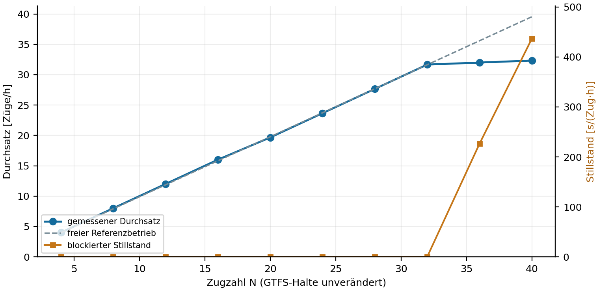
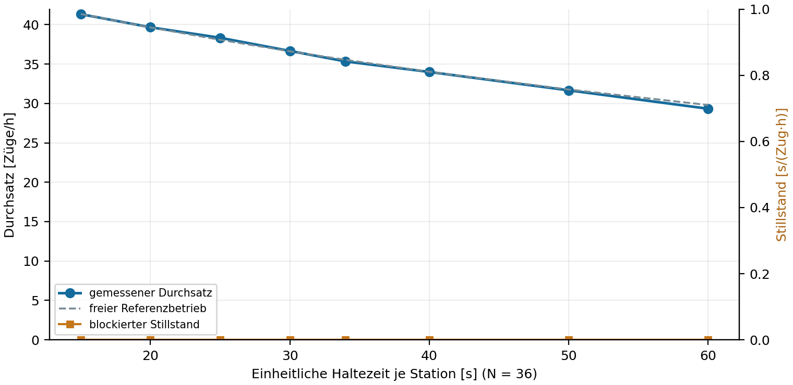
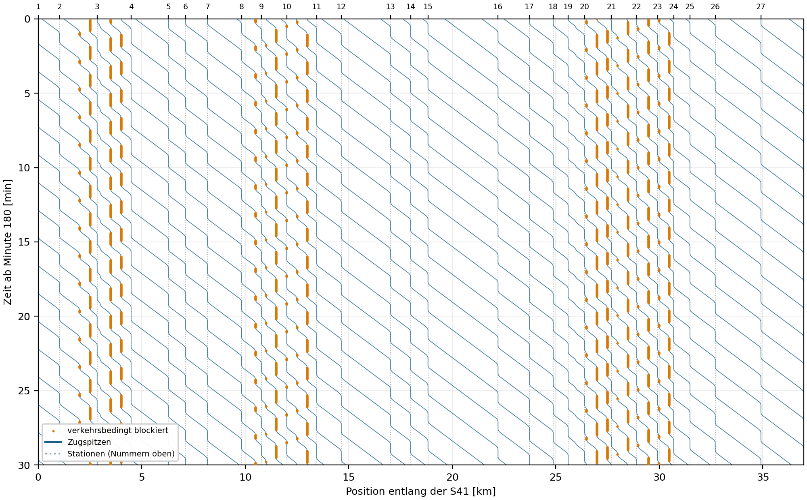

# S-Bahn-Ring – Woche 2

## Aufgabe 1: Referenzabgleich

Vor der Anpassung gewählte Größen: Abfahrt Beusselstraße bis Rückkehrankunft (Kalibrierung) und die 27 reinen Abschnittsfahrzeiten (Prüfung). Die GTFS-Referenz beträgt 3558 s, Fahrt S41 `308542990` am 14.10.2026 von 08:03:24 bis 09:02:42. Es handelt sich um Sollbetrieb.

Die effektive Geschwindigkeitsgrenze wird in allen zulässigen ganzzahligen Stufen 14–22 m/s untersucht; alle anderen Parameter bleiben unverändert. Das kleinste absolute Residuum ergibt sich bei 16 m/s = 57,6 km/h: 3599 s (+41 s, +1,15 %). Vorher: 3131 s. Der volle Modellumlauf beträgt 3641 s; der Anfangshalt von 42 s wird zum Vergleich abgezogen. Die Innenhalte ergeben genau die 870 s der Referenz. Endpunkte werden nicht als Nullhalte behandelt.

Abschnittsvalidierung: MAE vorher 15,8 s, nachher 8,0 s; RMSE vorher 16,5 s, nachher 11,4 s. Keine Nachoptimierung auf diese Werte. Prüfung und Kalibrierung verwenden denselben Fahrplan, keine unabhängigen Ist-Messungen.

## Aufgabe 2: Parameterstudien

Der Durchsatz steigt von 4,0 Zügen/h bei N=4 bis maximal 32,3 Zügen/h bei N=40. Bei N=40 werden 32,3 Züge/h und 436,7 s blockierter Stillstand je Zug und Stunde gemessen. Ab N=36 liegt die Zugfolge bei 112 s (32,14 Züge/h). Unterschiede um einen Zählwert entsprechen 0,33 Zügen/h; mehr Züge vergrößern hier vor allem Rückstaus.

Bei N=36 verändert eine Erhöhung der einheitlichen Haltezeit von 15 auf 60 s den Durchsatz von 41,3 auf 29,3 Züge/h. Längere Halte erhöhen die freie Umlaufzeit um 27 s je zusätzlicher Haltsekunde. Hier bleibt der blockierte Stillstand durchweg null. Bei ähnlichem Mittelwert liefert das gleichmäßige 34-s-Profil 35,33 Züge/h, das GTFS-Profil 32,00: Auch die Stationsverteilung der Halte ist entscheidend.

Bei der Zugzahlstudie bleiben die GTFS-Halte unverändert; bei der Haltezeitstudie sind alle Halte je Lauf gleich und N=36 bleibt fest. Zehn Zugzahlen und acht Haltezeiten, jeweils 60 min Einschwingen und 180 min Messung. Q ist die Zahl der Abfahrten an Station 1 im Intervall [3600,14400) geteilt durch 3 h. Blockierter Stillstand schließt geplante Stationshalte und langsames Folgen aus. Keine Zufallseinflüsse, deshalb ein deterministischer Lauf pro Parametersatz; `headway_std_s` ist die Streuung der beobachteten Zugabstände, keine Wiederholungsstreuung.

## Sanity Checks und Grenzen

20 Läufe mit jeweils zwölf zusätzlichen Sanity Checks; 68 MATLAB-Tests bestanden. Grundregeln: Zugerhaltung, ganzzahlige Ringzustände, zulässige Geschwindigkeiten/Beschleunigungen, korrekte synchrone Ringbewegung, Kollisionsfreiheit, Stationshalt, Bremsreserve und unabhängig rekonstruierter Abfahrtsdetektor. Die Modellprüfungen aus Woche 1 kontrollieren außerdem Stationsreihenfolge, Mindesthalte und exklusive Blockbelegung samt Freigabe am Zugende. Zwei Regressionen vergleichen On/Off und Fahrdynamik bei Standardgeschwindigkeit mit dem Original aus Woche 1. `sanity_checks.csv` und `matlab_tests.csv` enthalten die Ergebnisse.

Die effektive Geschwindigkeitsgrenze bündelt unbekannte örtliche Limits und Fahrplanreserven. Sie ist keine gemessene Fahrzeughöchstgeschwindigkeit. Ein guter Umlaufwert allein bestätigt die lokalen Fahrzeiten nicht. Ideale Haltepunkte, identische Fahrzeuge, konstante Beschleunigung und modellhafte 500-m-Blöcke erklären weitere Unterschiede. Die Ergebnisse gelten für diesen deterministischen Modellbereich und das endliche Messfenster; sie bestimmen keine reale Streckenkapazität.

## Code, Quellen und KI-Einsatz

Modellkern aus `../Woche 1/NaSch-SBahn/+sbahn` als lokales Paket `modell/+sbahn2`; die vier Bewegungsschritte und Blockregeln bleiben erhalten. Geändert wurden konfigurierbare effektive Geschwindigkeitsgrenze und Datenpfad. Quelldaten werden direkt aus Woche 1 gelesen. Das Original bleibt unverändert. `quellcode_herkunft.json` dokumentiert Hashes und betroffene Dateien.

VBB-GTFS, CC BY 4.0: https://unternehmen.vbb.de/digitale-services/datensaetze/ ; Gleisgeometrie © OpenStreetMap contributors, ODbL: https://www.openstreetmap.org/relation/14981 . Dokumentierter Abruf 14.10.2026; Herkunft, Rohdaten, Lizenzen und Geometriegrenzen im Daten-README aus Woche 1.

Codex unterstützte Übernahme und Erweiterung des MATLAB-Codes, Versuchsauswertung, Prüfungen und Text. Ergebnisse wurden in MATLAB R2026a ausgeführt, nicht aus Referenzwerten erfunden. Reproduktion: `SBahn2.m`, anschließend `py tools/erstelle_bericht.py`; vollständige Daten unter `ergebnisse/laeufe/`.
