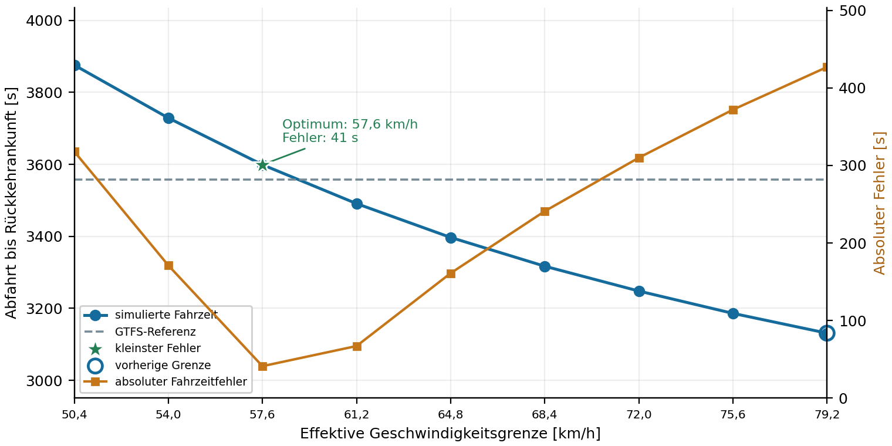
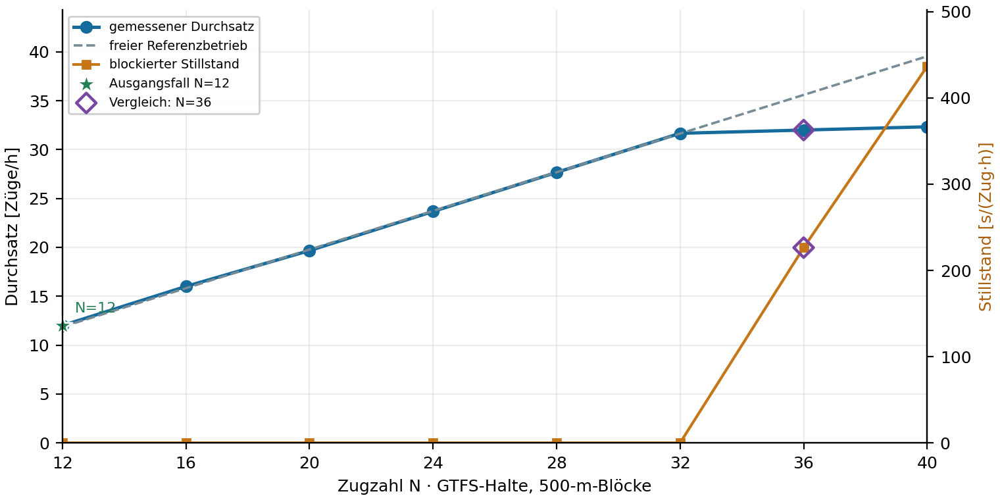
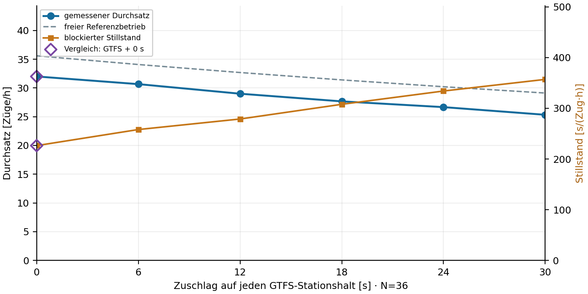
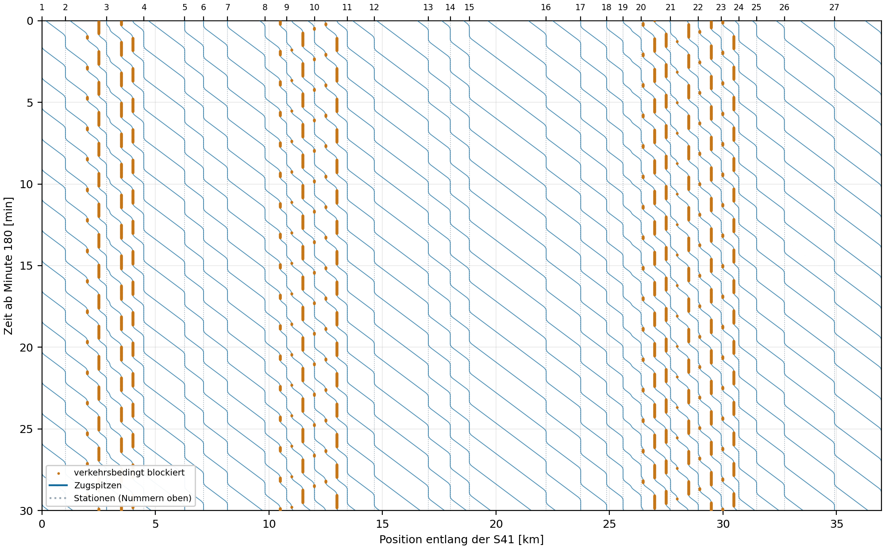

# S-Bahn-Ring – Woche 2

## Datenweg und Versuchskonvention

`run_sbahn2` gibt die tatsächlich berechneten Zahlen als `results.plotData` zurück und schreibt sie nach `diagrammdaten.mat`. Python liest diese Zahlen direkt ein und prüft auch die gezeichneten Linienkoordinaten. Alle aktuellen Läufe stehen in `laufverzeichnis.csv`; `diagrammwerte_pruefung.csv` dokumentiert die unabhängige Zahlenprüfung. Es werden keine Kurvenwerte von Hand im Zeichenskript eingetragen.

## Aufgabe 1: Geschwindigkeitsgrenze

Neun vollständig simulierte Kandidaten; ein freier Zug. Kleinster absoluter Fehler bei 57,6 km/h: 3599 statt 3558 s. Vorher: 3131 s bei 79,2 km/h. Kalibriert wird Abfahrt bis Rückkehrankunft; die 27 reinen Abschnittsfahrzeiten dienen anschließend zur Prüfung. Die Grenze ist ein effektiver Modellparameter, keine Messung der Fahrzeughöchstgeschwindigkeit.

## Aufgabe 2: Zugzahl

Die Untersuchung beginnt bei N=12 (grüner Stern) und umfasst 8 Zugzahlen. Bei N=36 werden 32,0 Züge/h und 226,4 s Stillstand je Zug und Stunde gemessen. Ab hier erhöhen weitere Züge vor allem die Wartezeit.

## Aufgabe 2: Haltezeit

Sechs Profile: GTFS plus 0, 6, 12, 18, 24 oder 30 s je Station, durchgehend N=36. GTFS+0 stimmt exakt mit N=36 aus der ersten Grafik überein (violette Rauten). GTFS+30 liefert 25,3 Züge/h und 357,0 s Stillstand je Zug und Stunde.

Es gelten jeweils dieselben GTFS-Stationsmediane plus Zuschlag. Der Nullzuschlag bei N=36 ist hinsichtlich vollständiger Trajektorien und Kennzahlen bitgenau identisch zum N=36-Fall der Zugzahlstudie. Die Phasenverschiebungen der sechs Anfangszustände betragen 0, 2, 6, 11, 15, 25 s; die regelmäßigen zeitlichen Zugabstände werden dabei erhalten. Die kleinste gültige Verschiebung verhindert bereits zu Beginn gemeinsam belegte Blöcke.

## Raum-Zeit-Diagramm

## Kennzahlen und Prüfungen

Je Lauf 60 Minuten Einschwingen und 180 Minuten Messung. Durchsatz: gezählte Abfahrten an Station 1 geteilt durch die Messdauer in Stunden. Stillstand: tatsächliche bewegungslose Sekunden ohne laufenden Stationshalt, normiert auf Zug und Stunde. Die gemeinsame Achsenskalierung macht beide Parameterdiagramme vergleichbar. Ohne Zufallseinflüsse genügt ein deterministischer Lauf je Einstellung.

71 MATLAB-Tests, 25 ausgewertete Läufe und 377 unabhängig geprüfte Zahlenwerte. Grundregeln, vollständige Tabellenexporte, gemessene Referenzfahrzeiten, gemeinsamer Betriebspunkt und optimale Geschwindigkeitsmarkierung sind geprüft. `headway_std_s` beschreibt zeitliche Zugabstände, keine Wiederholungsstreuung.

## Quellen, Grenzen und KI

VBB-GTFS: S41 trip_id 308542990 am 14.10.2026; Sollzeiten. Kartierte Geometrie: © OpenStreetMap contributors, Relation 14981. Quellen und Lizenzen im Daten-README aus Woche 1. Ideale Haltepunkte, identische Fahrzeuge, vereinfachte Blöcke und effektive Geschwindigkeitsgrenze begrenzen die Aussage über reale Streckenkapazität. Codex unterstützte Implementierung, Versuchsprüfung und Text. Alle Zahlen stammen aus ausgeführten MATLAB-Läufen.
