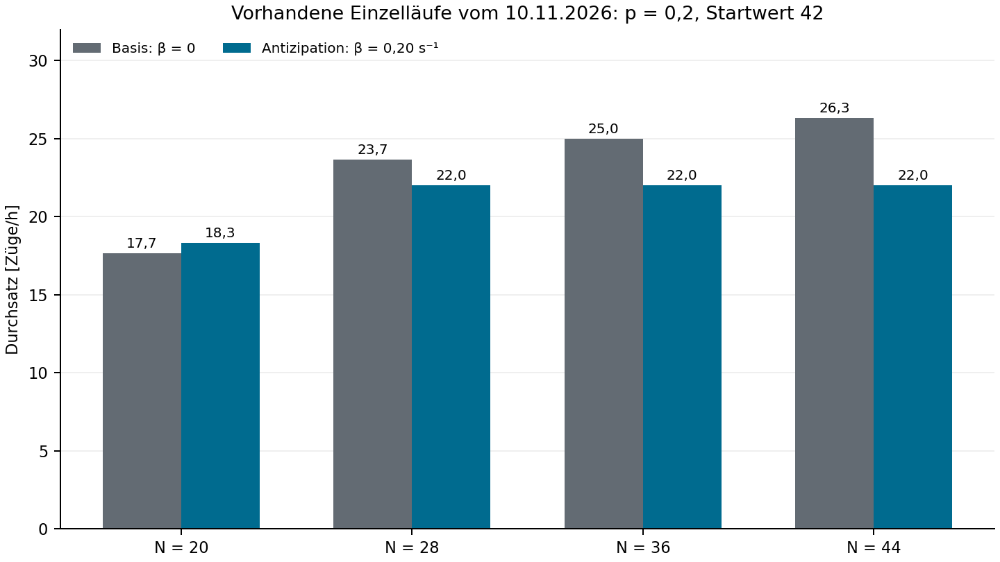

# Hypothetischer Brandbrief – Aufgabe 3

Berlin, 11. November 2026

An die Senatsverwaltung für Mobilität, Verkehr, Klimaschutz und Umwelt
Bereich öffentlicher Personennahverkehr, Berlin

## Ringbahn: Antizipation vor einer Einführung nachbessern

Sehr geehrte Damen und Herren,

längere Stationshalte können sich im dichten S-Bahn-Verkehr zu Rückstauketten fortpflanzen. Die S-Bahn Berlin nennt starken Fahrgastwechsel als Verzögerungsursache [1]. Ein Zug hält einen Abschnitt länger besetzt; Nachfolger bremsen und warten. Eine zusätzliche Fahrregel sollte deshalb nachweisbar helfen, bevor sie als Kapazitätsmaßnahme empfohlen wird.

Unser Vorschlag ist eine vorausschauende Bremsregel: Ein Zug passt sich dem langsameren Vorgänger an, wenn dessen Zugende im ersten oder zweiten Block voraus liegt. Die Stärke wird durch β = 0,20 s⁻¹ bestimmt; die Verzögerung bleibt auf 1 m/s² begrenzt. Ziel ist, Brems- und Stauketten zu mindern. Im Basismodell entfällt diese Zusatzregel (β = 0). Die vorhandenen Signal- und Sicherheitsregeln gelten in beiden Varianten.

Verglichen werden vorhandene Einzelläufe vom 10.11.2026: S41-Geometrie, 27 Stationen, 117 aus OSM abgeleitete Abschnitte, 148-m-Züge, Raster 1 m/1 s. Vorgabe 80 km/h, effektiv 79,2 km/h. p = 0,2 je Blockeinfahrt (Bremsen auf halbe Geschwindigkeit) und Stationsankunft (Zufallszusatz 0–120 s); GTFS-Basishalte ohne festen Zuschlag. Je Punkt 60 min Einschwingen und 180 min Messung, Startwert 42. Gezählt werden Abfahrten an Station 1 pro Stunde. Neue Messungen wurden für diesen Brief nicht angesetzt.

Bei N = 28 beträgt der Durchsatz 23,67 Züge/h ohne und 22,00 Züge/h mit der Zusatzregel: -1,67 Züge/h bzw. -7,0 %. Bei N = 36 und 44 fallen die Vergleichswerte ebenfalls niedriger aus; bei N = 20 liegt der Wert etwas höher. Die vorliegenden Läufe zeigen damit keinen durchgängigen Kapazitätsgewinn.

| Züge N | Basis [Züge/h] | Antizipation [Züge/h] | Differenz [Züge/h] | Änderung |

|---:|---:|---:|---:|---:|

| 20 | 17,67 | 18,33 | 0,67 | 3,8 % |

| 28 | 23,67 | 22,00 | -1,67 | -7,0 % |

| 36 | 25,00 | 22,00 | -3,00 | -12,0 % |

| 44 | 26,33 | 22,00 | -4,33 | -16,5 % |

Die Regel kann schon vor der notwendigen Sicherheitsbremsung eingreifen. Solange der Vorgänger langsamer ist, wird auch die erneute Beschleunigung begrenzt. Das kann die Fahrt verzögern und Zugfolgeabstände vergrößern. Die beobachteten Durchsatzverluste bei hoher Zugzahl sprechen deshalb gegen eine unveränderte Übernahme als Kapazitätsmaßnahme.

Aussagekraft: Pro Punkt liegt nur ein Lauf vor. Zwar sind Parameter und Startwert gleich, doch eine geänderte Ereignisreihenfolge kann Zufallszahlen anderen Zügen bzw. Ereignissen zuordnen. Die Störungsverläufe sind daher nicht zuverlässig gepaart. Die Werte sind ein Hinweis, kein statistisch abgesicherter kausaler Wirksamkeitsnachweis; Konfidenzintervalle lassen sich daraus nicht belastbar angeben.

Erwarteter Nutzen und Aufwand: Eine geeignete Antizipation könnte Rückstauketten verringern. Das ist hier kein nachgewiesener Vorteil. Dem stehen mögliche Fahrzeit- und Kapazitätsverluste gegenüber. Im Betrieb wären verlässliche Positions- und Geschwindigkeitsdaten des Vorgängers, Datenübertragung, Integration in die Fahrzeugsteuerung und Sicherheitsnachweise nötig. Geldkosten, Energie und Fahrkomfort wurden nicht modelliert.

Übertragungsgrenzen: OSM-Signale sind keine bestätigten Blockgrenzen, GTFS enthält Sollhalte. p und die Gleichverteilung sind Versuchsannahmen. Andere Linien, Zuläufe, Fahrgastdynamik, Personal- und Fahrzeugdisposition fehlen. N bezeichnet keine reale S41-Flottenstärke. Die Senatsantwort von 2018 nennt das Zusammenwirken von Fahr-/Bremsverhalten, Haltezeiten und Betriebsqualität [2]; deren Stadtbahn-Kapazitätszahlen werden hier nicht auf die Ringbahn übertragen.

Unsere Empfehlung: Lassen Sie die konkrete Regel überarbeiten und vor einer betrieblichen Einführung erneut bewerten. Eine Variante sollte nur bei tatsächlich notwendiger Verzögerung eingreifen und die Beschleunigung nicht länger als nötig begrenzen. Das ist ein noch ungeprüfter Änderungsvorschlag. Erforderlich wären anschließend echte Block-/Betriebsdaten und wiederholte Vergleiche mit ereignisbezogen gleichen Störungen. Die vorhandenen Ergebnisse rechtfertigen derzeit keine Einführung dieser Regel als Kapazitätshebel.

Mit freundlichen Grüßen
Projektgruppe PR 1.3 – Modellbildung und Simulation

[1] S-Bahn Berlin: Gründe für Störungen. sbahn.berlin/fahren/bauen-stoerung/gruende-fuer-stoerungen/
[2] Abgeordnetenhaus Berlin: Anfrage 18/17266, Antwort vom 20.12.2018, S. 1–3.
pardok.parlament-berlin.de/starweb/adis/citat/VT/18/SchrAnfr/s18-17266.pdf
Abruf: 11.11.2026. Vollständige Quellen und Herkunft der acht Bestandswerte sind im Abgabepaket enthalten.

Hypothetisches Schreiben für eine Laboraufgabe. Nicht versandt.
