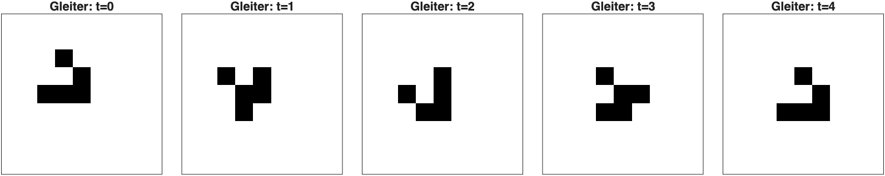
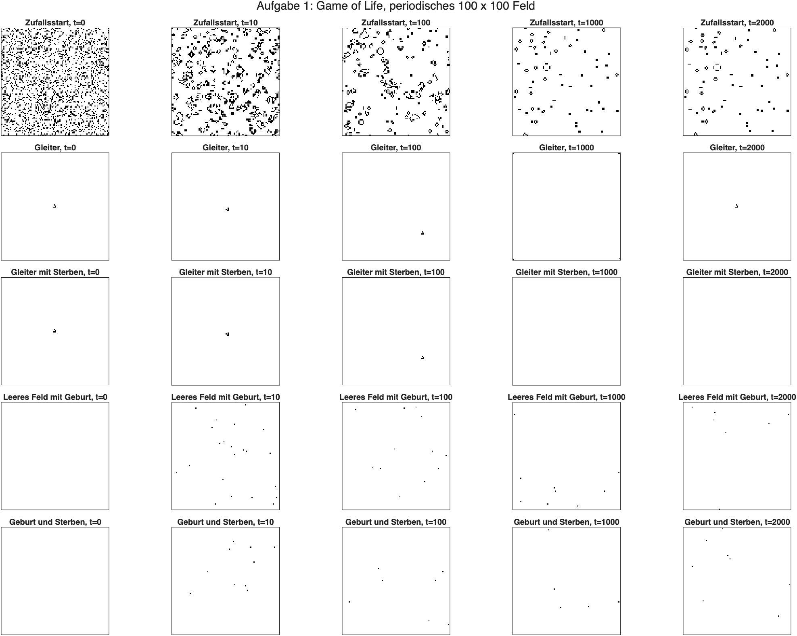
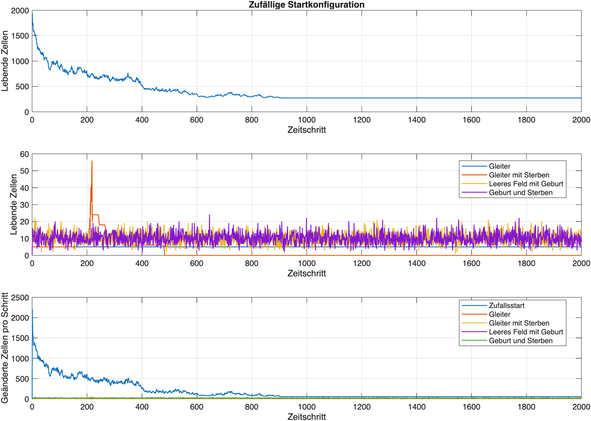
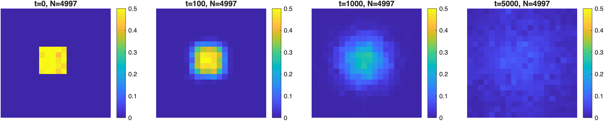
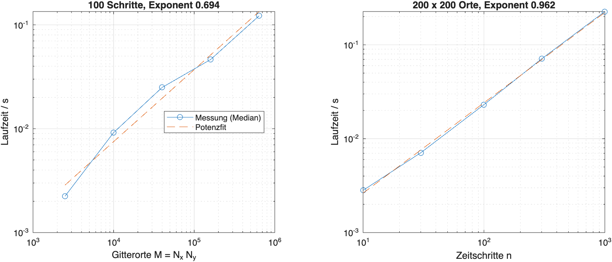
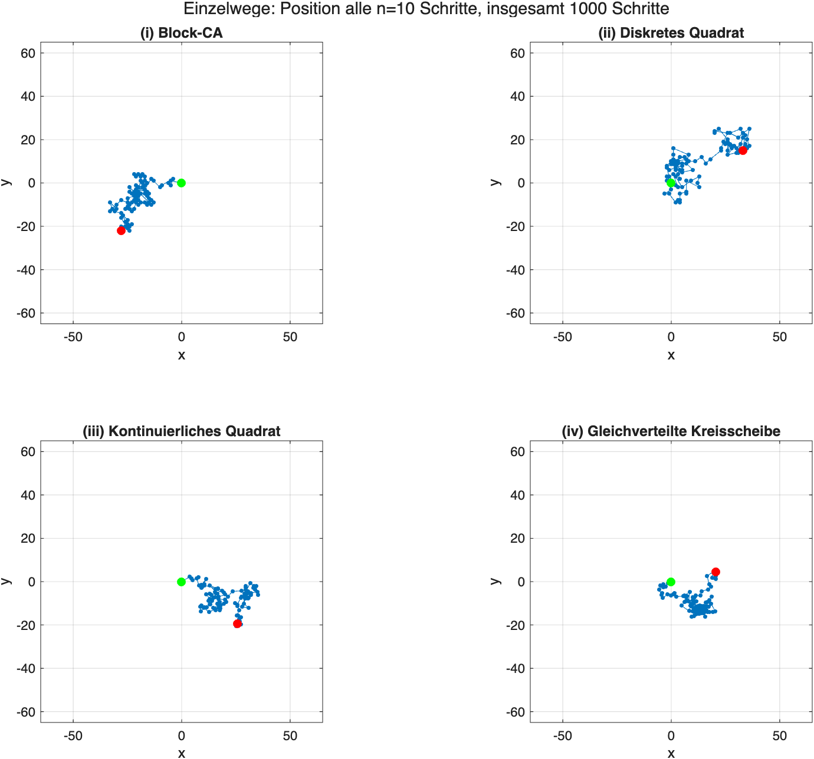
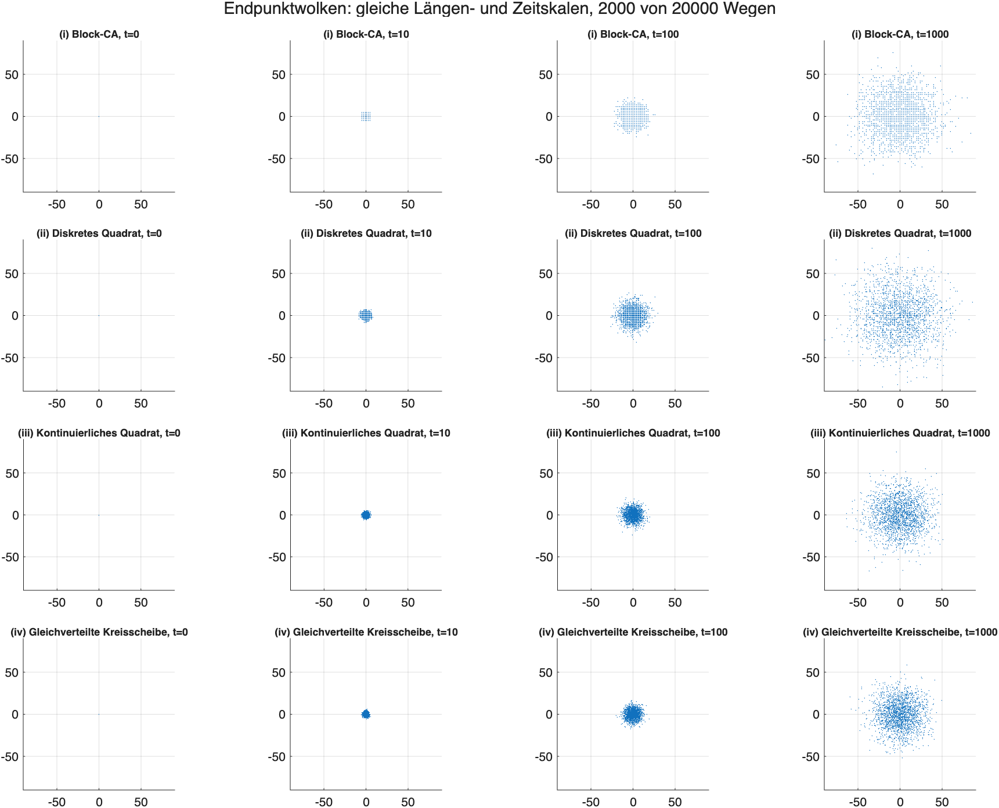
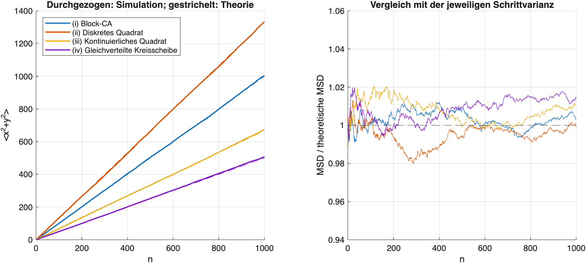

# Lösung: PR 2.1 – Diffusions-Blockautomat

Aufgabenblatt: `Diffusion1.pdf`, Version 9. November 2026. Die Lösung verwendet die bereitgestellten MATLAB-Vorlagen. Geprüfter Lauf: 2026-11-18 08:24:11 (lokale Rechnerzeit), MATLAB 26.1.0.3203278 (R2026a), Apple Silicon (MACA64). Alle Zufallsversuche haben feste Startwerte für den Zufallszahlengenerator. Konkrete Messwerte stehen zusätzlich in `ergebnisse/`.

## Programme starten

MATLAB im Ordner `Woche 4` öffnen und ausführen:

```matlab
results = run_diffusion1;
```

Der Aufruf prüft die Implementierung, bearbeitet beide Aufgaben und speichert PNG-Diagramme, CSV-Tabellen, JSON-Zusammenfassungen und `ergebnisse/diffusion1_ergebnisse.mat`. Die Bilderzeugung erfolgt ohne Animationsfenster. Für eine interaktive Diffusionsanimation kann im Unterordner `diff-2d` zusätzlich `demo` aufgerufen werden.

Die beiden Vorlagenordner enthalten gleichnamige Funktionen. Deshalb wechselt der Hauptaufruf jeweils das Arbeitsverzeichnis und entfernt die drei gleichnamigen Hilfsfunktionen aus dem Funktionscache. Beide Ordner sollten nicht gleichzeitig über `genpath` in den Suchpfad aufgenommen werden.

## Aufgabe 1 – Game of Life

### Grundregel

Es sei \(s_{ij}(t)\in\{0,1\}\) der Zustand einer Zelle und

\[
m_{ij}(t)=\sum_{(u,v)\in\{-1,0,1\}^2\setminus\{(0,0)\}}
s_{i+u,j+v}(t)
\]

die Anzahl ihrer acht lebenden Nachbarn. Alle Indizes werden periodisch fortgesetzt. Die deterministische Folgezelle ist

\[
\widetilde s_{ij}(t+1)=
\mathbf1_{\{m_{ij}=3\}}\;\lor\;
\left(s_{ij}(t)\land\mathbf1_{\{m_{ij}=2\}}\right).
\]

Eine tote Zelle entsteht bei genau drei Nachbarn; eine lebende Zelle überlebt bei zwei oder drei Nachbarn. Alle Zellen werden gleichzeitig aus dem alten Zustand aktualisiert.

### (a) Zufällige Startkonfiguration

Versuch: periodisches Feld mit \(100\times100\) Zellen, anfängliche Besetzungswahrscheinlichkeit \(0{,}2\), 2000 Schritte, Seed 2101.

Anfangs zerfallen viele zufällige Gruppen; an anderen Stellen entstehen kurzzeitig neue Zellen. Die Zahl lebender Zellen nimmt insgesamt meist ab, verläuft aber nicht monoton. Aus längeren Wechselwirkungen können ruhende Muster, Oszillatoren und wandernde Strukturen entstehen. Es gibt keinen Erhaltungssatz für die Zellzahl.

Ein später unveränderter Zellbestand allein beweist keinen unveränderten Zustand: Ein Blinker hat konstant drei lebende Zellen, obwohl seine Orientierung in jedem Schritt wechselt. Deshalb zeichnet das Programm zusätzlich die Anzahl geänderter Zellen auf. Aus einer endlichen Beobachtung darf keine allgemeine Konvergenzaussage abgeleitet werden; auf einem endlichen deterministischen Feld wird schließlich ein Zustand wiederholt und die weitere Entwicklung damit periodisch, unter Umständen mit langer Periode.

### (b) Gewählte Struktur: Gleiter

Startmuster, wobei `1` eine lebende Zelle bezeichnet:

```text
0 1 0
0 0 1
1 1 1
```

Nach vier Schritten hat der Gleiter wieder dieselbe Gestalt, um eine Zeile nach unten und eine Spalte nach rechts verschoben. Er besitzt fünf lebende Zellen. Seine translatorische Periode beträgt 4; seine Geschwindigkeitskomponenten sind je \(1/4\) Gitterabstand pro Schritt. Nach Erreichen des Randes tritt er wegen der periodischen Randbedingungen an der gegenüberliegenden Seite wieder ein.

Auf dem verwendeten quadratischen \(100\times100\)-Torus wiederholt sich der vollständige Zustand nach 400 Schritten. Der Funktionstest prüft die exakte Verschiebung nach vier Schritten auch beim Überqueren des Randes. Die Bewegung wird hier durch den exakten Vier-Schritt-Test geprüft. Als weiterführende Quelle dient [LifeWiki: Glider](https://conwaylife.com/wiki/Glider).



### (c) Zusätzliches Sterben mit Wahrscheinlichkeit \(10^{-3}\)

Nach jeder deterministischen Aktualisierung wird jede dann lebende Zelle unabhängig mit Wahrscheinlichkeit \(p_d=10^{-3}\) entfernt:

\[
s_{ij}(t+1)=\widetilde s_{ij}(t+1)\,
\mathbf1_{\{U_{ij}(t)\ge p_d\}},\qquad U_{ij}(t)\sim U[0,1).
\]

In MATLAB:

```matlab
G = G & (rand(size(G)) >= pDeath);
```

Solange kein zusätzliches Sterben auftritt, bewegt sich der Gleiter unverändert. Schon der Verlust einer seiner Zellen kann die Struktur zerstören oder in andere Muster überführen. Ruhende Restmuster können durch weitere Todesereignisse ebenfalls zerfallen. Ohne spontane Geburten ist das leere Feld ein absorbierender Zustand.

Solange der Gleiter ungestört ist, beträgt die Wahrscheinlichkeit mindestens eines Todesereignisses in einem Schritt

\[
q=1-(1-10^{-3})^5\approx0{,}00499001.
\]

Die mittlere Wartezeit bis zum ersten solchen Ereignis ist daher \(1/q\approx200{,}4\) Schritte. Das ist keine deterministische Lebensdauer und auch keine Aussage, dass das Feld beim ersten Ereignis sofort leer wird. Die Wahrscheinlichkeit einer bis einschließlich Schritt \(t\) vollständig ungestörten Geschichte ist \((1-p_d)^{5t}\).

### (d) Spontane Entstehung mit Wahrscheinlichkeit \(10^{-3}\)

Für diesen Teil startet das Feld leer. Zunächst wird ausschließlich die Geburtsstörung verwendet, also \(p_b=10^{-3}\) und \(p_d=0\). Nach der Life-Regel erhält jede dann tote Zelle unabhängig eine Geburtsmöglichkeit:

\[
s_{ij}(t+1)=\widetilde s_{ij}(t+1)\;\lor\;
\mathbf1_{\{V_{ij}(t)<p_b\}}.
\]

```matlab
G = G | (rand(size(G)) < pBirth);
```

Im ersten Schritt entstehen auf dem \(100\times100\)-Feld im Mittel 10 Zellen. Isolierte Zellen sterben beim nächsten deterministischen Schritt gewöhnlich wieder. Zufällige Nachbarschaften können jedoch langlebige oder oszillierende Muster erzeugen. Durch ständig neue Geburten bleibt das Feld dynamisch; der leere Zustand ist nicht mehr absorbierend. Seine erneute Entstehung ist auf einem endlichen Feld zwar möglich, beendet den Versuch aber nicht.

Die Dichte bleibt nicht zwingend bei \(10^{-3}\): Die Life-Regel erzeugt zusätzliche Zellen, Muster können sich ansammeln und Kollisionen können sie wieder vernichten. Ein beobachteter Mittelwert gilt für das gewählte Feld, den Seed und das Messfenster; er ist kein universeller Gleichgewichtswert.

Falls Teil (d) als zusätzliche Erweiterung von (c) verstanden wird, zeigt ein fünfter Versuch auch die Kombination \(p_b=p_d=10^{-3}\). In dieser Variante gilt die festgelegte Reihenfolge **Life-Regel → zusätzliches Sterben → spontane Geburt**. Eine gerade gestorbene Zelle kann im selben Schritt wieder entstehen.

### Ergebnisse Aufgabe 1





Die konkreten Messwerte werden in `aufgabe1_population.csv` und `aufgabe1_summary.json` gespeichert.

Im ausgeführten Versuch ergeben sich folgende Zellzahlen:

| Schritt | Zufallsstart | Gleiter | Gleiter mit Sterben | Leeres Feld mit Geburt | Geburt und Sterben |
|---|---:|---:|---:|---:|---:|
| 0 | 1949 | 5 | 5 | 0 | 0 |
| 10 | 1524 | 5 | 5 | 22 | 10 |
| 100 | 828 | 5 | 5 | 12 | 7 |
| 1000 | 273 | 5 | 0 | 9 | 5 |
| 2000 | 273 | 5 | 0 | 7 | 8 |

Der Gleiter erleidet bei Schritt 153 das erste zusätzliche Sterben. Das veränderte Muster wächst durch die normale Life-Regel vorübergehend sogar auf 56 Zellen bei Schritt 218; bei Schritt 483 ist das Feld vollständig leer. Zusätzliches Sterben bedeutet somit keine monoton fallende Zellzahl. Beim Zufallsstart bleiben zuletzt 273 Zellen erhalten, während sich bei Schritt 2000 noch 56 Zellzustände ändern: Es ist also kein vollständig ruhendes Endbild. Im Versuch mit ausschließlich spontanen Geburten liegen im letzten 500-Schritt-Fenster im Mittel 10,066 lebende Zellen vor, mit Werten zwischen 1 und 21. In diesem Messfenster dominieren somit kurzlebige vereinzelte Zellen; eine große dauerhafte Kolonie ist in diesem Lauf nicht entstanden.

## Aufgabe 2 – Diffusion mittels 2D-Block-CA

### (a) Verbale und mathematische Beschreibung der Update-Regel

An jedem Gitterort gibt es vier binäre Richtungskanäle. Zur Unterscheidung von der allgemeinen Zustandsvariable werden sie hier \(a,b,c,d\) genannt. Im Programm bezeichnet die erste Matrixdimension die Zeile:

| Kanal | Richtung | Verschiebung (Zeile, Spalte) |
|---|---|---|
| \(a\), Index 1 | oben | \((-1,0)\) |
| \(b\), Index 2 | links | \((0,-1)\) |
| \(c\), Index 3 | rechts | \((0,+1)\) |
| \(d\), Index 4 | unten | \((+1,0)\) |

Mehrere Teilchen dürfen denselben Gitterort in verschiedenen Kanälen besetzen; derselbe Kanal enthält höchstens ein Teilchen. Die fünfte Ebene der MATLAB-Matrix ist eine Hindernismaske und kein Teilchenkanal. Für die Aufgabe ist sie überall `false`.

**1. Richtungsänderung beziehungsweise Kollision.** Für jeden Ort und jeden Schritt wird ein unabhängiges faires Zufallsbit \(\xi_{ij}\) verwendet. Alle an diesem Ort vorhandenen Richtungen werden gemeinsam um \(+90^\circ\) oder \(-90^\circ\) permutiert:

\[
\begin{aligned}
a^*&=(\xi\land b)\lor(\neg\xi\land c),\\
b^*&=(\xi\land d)\lor(\neg\xi\land a),\\
c^*&=(\xi\land a)\lor(\neg\xi\land d),\\
d^*&=(\xi\land c)\lor(\neg\xi\land b).
\end{aligned}
\]

Also gilt für \(\xi=1\): \((a^*,b^*,c^*,d^*)=(b,d,a,c)\), und für \(\xi=0\): \((c,a,d,b)\). Dies ist keine vom lokalen Besetzungszustand abhängige Stoßregel: Auch ein einzelnes Teilchen wird gedreht. Teilchen am selben Ort teilen das Zufallsbit; ihre Wege sind deshalb nicht allgemein voneinander unabhängig.

**2. Versetzung beziehungsweise Streaming.** Anschließend wird jeder Kanal um einen Gitterort in seine neue Richtung verschoben:

\[
\begin{aligned}
a_{ij}(t+1)&=a^*_{i+1,j}(t),&
b_{ij}(t+1)&=b^*_{i,j+1}(t),\\
c_{ij}(t+1)&=c^*_{i,j-1}(t),&
d_{ij}(t+1)&=d^*_{i-1,j}(t).
\end{aligned}
\]

Alle Indizes sind modulo der jeweiligen Gittergröße zu verstehen. `circshift` implementiert genau diese periodischen Verschiebungen. Weil eine Teilchenrichtung vor jeder Versetzung um 90 Grad dreht, wechseln horizontale und vertikale Schritte strikt ab. Das Modell ist daher mikroskopisch kein Random Walk mit vier voneinander unabhängig gewählten Richtungen.

Die lokale Kollision ist eine Permutation und erhält \(a+b+c+d\). Streaming verteilt die Teilchen nur um. Damit ist die Gesamtteilchenzahl

\[
N=\sum_{ij}(a_{ij}+b_{ij}+c_{ij}+d_{ij})
\]

exakt konstant. Der Impuls ist dagegen nicht erhalten. Aus zwei Schritten resultieren für ein einzelnes Teilchen diagonal gerichtete Verschiebungen \((\pm1,\pm1)\). Die Vorzeichen sind gleichwahrscheinlich.

Für das gemittelte Verhalten gilt beispielsweise

\[
\mathbb E[a_{ij}(t+1)]
=\tfrac12\mathbb E[b_{i+1,j}(t)+c_{i+1,j}(t)],
\]

analog für die übrigen Kanäle. Für große Orts- und Zeitskalen entsteht die Diffusionsgleichung

\[
\partial_t\rho=D\nabla^2\rho,\qquad D=\frac{\ell^2}{4\tau}.
\]

Hier sind Gitterabstand \(\ell=1\) und Zeitschritt \(\tau=1\), also \(D=1/4\). Die periodischen Ränder verteilen einen anfänglichen Konzentrationsfleck über den Torus. Diese Kontinuumsbeschreibung ist eine Näherung nach räumlicher Mittelung: Auf dem feinen Gitter bleiben Paritätsbedingungen sichtbar. Nach jedem Einzelschritt wechselt ein Teilchen die Schachbrettfarbe.

### (b) Tests und Beispielsimulation

Folgende Tests werden automatisiert ausgeführt:

1. Ein leeres periodisches Gitter bleibt leer; ein in allen vier Kanälen volles Gitter bleibt voll.
2. Alle fünf Initialisierungsszenarien lassen sich ausführen; Datentyp und Matrixgröße bleiben erhalten.
3. Die Teilchenzahl bleibt bei allen getesteten Szenarien über viele Updates exakt konstant.
4. Für alle 16 möglichen lokalen Belegungen wird die lokale Teilchenzahl vor und nach der Kollision verglichen, nachdem das Streaming rückgängig gemacht wurde.
5. Ein einzelnes Teilchen bleibt genau ein Teilchen. Jeder Schritt hat Manhattan-Länge 1 und die Bewegungsachse wechselt immer.
6. Ein geeignet platzierter Einzelzustand prüft gleichzeitig den Richtungswechsel und das Wiedereintreten am gegenüberliegenden periodischen Rand.
7. Ein Ensemble von 20.000 unabhängigen Einteilchenwegen liefert die theoretische mittlere quadratische Entfernung innerhalb einer vorab gewählten Toleranz von 4 Prozent. Das ist ein statistischer Plausibilitätstest und kein Beweis.

Zusätzlich gibt es Tests der bekannten Life-Muster sowie der extremen und statistischen Geburts-/Sterbewahrscheinlichkeiten. Die 15 Regeltests werden mit `pruefe_diffusion1` gestartet. Der zusätzliche MSD-Test gehört zur Ausführung von `aufgabe2` und wird im vollständigen Lauf ebenfalls geprüft.

Als Beispiel wird ein Rechteck auf einem \(200\times200\)-Gitter simuliert. Dargestellt ist die mittlere Kanalbelegung in \(10\times10\)-Boxen:

\[
\rho_B=\frac{1}{4\,10^2}\sum_{(i,j)\in B}\sum_{k=1}^4G_{ijk}.
\]

Die Konzentration verbreitert sich; das anfangs lokale Maximum nimmt ab. Nach langer Zeit ist das grob gemittelte Feld deutlich gleichmäßiger, mit verbleibenden Teilchenfluktuationen. Die globale mittlere Belegung \(N/(4M)\) bleibt konstant.

Gemessen werden zu allen vier Ausgabezeitpunkten exakt **4997 Teilchen**. Daraus folgt die konstante mittlere Kanalbelegung \(4997/(4\cdot200^2)=0{,}03123125\). Nach 5000 Schritten ist der Konzentrationsfleck noch nicht vollständig ausgeglichen; die Standardabweichung der Boxmittel beträgt ungefähr 0,01897.



Bei der Bearbeitung wurden folgende Fehler beziehungsweise Abweichungen der Vorlage korrigiert: `demo` verwendet jetzt periodische Ränder; im Szenario `cg` stimmen die Dimensionen der Zufallsmatrix mit der adressierten Box überein; das Einteilchenszenario erlaubt auch ungerade Gittergrößen; die Rechteckindizes sind auch für sehr kleine Gitter gültig. Die Zufallswörter enthalten nun auch den Wert 0. Damit sind ihre einzelnen Bits exakt fair; das ursprüngliche Ausschließen von 0 erzeugte eine winzige Verzerrung.

### (c) Laufzeit in Abhängigkeit von Gittergröße und Schrittzahl

Sei \(M=N_xN_y\) die Zahl der Gitterorte und \(n\) die Zahl der Zeitschritte. Jeder Schritt bearbeitet vier Kanäle an allen Orten, einschließlich Zufallsbits, logischer Operationen und vier Verschiebungen. Deshalb gilt

\[
T(M,n)=\Theta(Mn),\qquad S(M)=\Theta(M).
\]

Zählt man die vier binären Kanäle als einzelne Zellen, ist die Zellzahl \(4M\); der konstante Faktor ändert die Skalierung nicht. Bei quadratischem Feld mit Seitenlänge \(L\) folgt \(T=\Theta(L^2n)\), nicht \(\Theta(Ln)\).

**Messverfahren:** Grafik und Initialisierung ausschließen, JIT-Aufwärmlauf durchführen, pro Parameterkombination fünf Wiederholungen messen und den Median verwenden. Variiert werden \(M=2500,10000,40000,160000,640000\) bei 100 Schritten sowie \(n=10,30,100,300,1000\) bei \(M=40000\). Gemessen wird das bereitgestellte, vektorisierte `myUpdate`, nicht das vereinfachte Einteilchenmodell.

Ein Potenzfit \(\log T=\alpha\log M+c\) beziehungsweise \(\log T=\beta\log n+c\) sollte Exponenten in der Nähe von 1 ergeben. Cache-Effekte, Speicherbandbreite, feste Aufrufkosten und Messschwankungen können Abweichungen verursachen. Die Bitgenerierung erfolgt jeweils für Blöcke von bis zu 32 Schritten, wodurch ebenfalls kleine Laufzeitstufen entstehen können.



Die CSV-Dateien `aufgabe2_laufzeit_zellen.csv` und `aufgabe2_laufzeit_schritte.csv` enthalten Median, Minimum und Maximum in Sekunden. MATLAB-Version und die Fitexponenten stehen in `aufgabe2_summary.json`. Die Messungen sind rechnerabhängig.

Im abschließenden Lauf auf diesem Mac unter MATLAB 26.1.0.3203278 (R2026a) (MACA64) wurden folgende Mediane gemessen:

| Gitterorte \(M\) | Laufzeit für 100 Schritte / s |
|---:|---:|
| 2500 | 0,002245 |
| 10000 | 0,009174 |
| 40000 | 0,024968 |
| 160000 | 0,046391 |
| 640000 | 0,122324 |

| Schritte \(n\) bei 40000 Gitterorten | Laufzeit / s |
|---:|---:|
| 10 | 0,002819 |
| 30 | 0,007083 |
| 100 | 0,023063 |
| 300 | 0,070950 |
| 1000 | 0,226371 |

Die Fits liefern \(\alpha=0,694\) bezüglich der Gitterorte und \(\beta=0,962\) bezüglich der Schritte. Die Schrittzahlabhängigkeit liegt damit nahe an der theoretischen Linearität. Die Größenreihe zeigt auch im erweiterten Bereich bis 640000 Gitterorte eine sublineare effektive Potenz; sie bestätigt den asymptotischen Exponenten 1 quantitativ noch nicht. Daraus lässt sich keine grundsätzlich sublineare Komplexität ableiten: Das Programm bearbeitet jeden Gitterort pro Schritt. Feste Kosten, Speicherzugriffe und größenabhängige MATLAB-Optimierungen sind mögliche Einflüsse, wurden aber nicht einzeln vermessen. Laufzeiten sind rechner- und lastabhängig. Die fünf Einzelmessungen je Einstellung sind zusätzlich im JSON-Ergebnis gespeichert.

### (d) Vier Random-Walk-Modelle in der unendlichen Ebene

Alle Wege starten bei \(\mathbf R_0=(0,0)\). Sie werden ohne Moduloabbildung in unbeschränkten Koordinaten gespeichert. Für Modell (i) wird die exakte Richtungsübergangsregel des CA auf ein einzelnes Teilchen angewendet. Dadurch braucht man für die unendliche Ebene keine endliche Gittermatrix; außerdem entfallen Rand- und Speicherartefakte. Ein gesonderter Test des vollständigen Gitterautomaten prüft dessen tatsächlichen Einteilchenweg mit fortlaufend entfalteten Koordinaten.

**Verteilungsannahmen:** In (ii) sind beide Komponenten unabhängig und diskret gleichverteilt; in (iii) unabhängig und stetig gleichverteilt. In (iv) wird gleichverteilt bezüglich der Fläche der Einheitskreisscheibe gezogen. Das Aufgabenblatt nennt bei (iv) nur den erlaubten Bereich und legt die Verteilung nicht ausdrücklich fest. Die folgende Wahl ist deshalb eine offengelegte Modellannahme.

#### (i) Gegebener 2D-CA

Jeder Schritt hat Länge 1 und ist senkrecht zum vorherigen Schritt. Für eine bekannte bisherige Geschichte ist die nächste Verschiebung gleichwahrscheinlich eine der beiden entgegengesetzten senkrechten Richtungen. Somit hat sie bedingten Mittelwert 0; Verschiebungen zu verschiedenen Zeiten besitzen verschwindende Kreuzkorrelation, obwohl ihre Achsen nicht unabhängig sind. Daraus folgt exakt

\[
\mathbb E[\mathbf R_n]=0,\qquad
\mathbb E[|\mathbf R_n|^2]=n.
\]

Eine gleichverteilte anfängliche Richtung macht die zweiten Momente bereits ab dem ersten Schritt isotrop: \(\operatorname{Var}(x_n)=\operatorname{Var}(y_n)=n/2\). Bei fest gewählter Anfangsrichtung können sich die beiden Varianzen für ungerades \(n\) um 1 unterscheiden; die Summe bleibt \(n\).

#### (ii) Diskrete Schrittkomponenten

\[
\Delta x,\Delta y\overset{\mathrm{unabh.}}\sim
U\{-1,0,+1\}.
\]

Es gibt neun gleichwahrscheinliche Schritte, einschließlich eines Nullschritts und vier Diagonalschritten. Daher ist \(\mathbb E[\Delta x^2]=2/3\) und

\[
\mathbb E[|\mathbf R_n|^2]=\frac43n.
\]

#### (iii) Stetige Schritte im Quadrat

\[
\Delta x,\Delta y\overset{\mathrm{unabh.}}\sim U[-1,1],
\qquad\operatorname{Var}(\Delta x)=\frac13.
\]

Somit ist

\[
\mathbb E[|\mathbf R_n|^2]=\frac23n.
\]

#### (iv) Stetige Schritte in der Kreisscheibe

Für gleichverteilte Winkel \(\theta=2\pi V\) und gleichverteilte Fläche ist

\[
r=\sqrt U,\quad
\Delta x=r\cos\theta,\quad\Delta y=r\sin\theta,
\qquad U,V\sim U[0,1).
\]

Die radiale Dichte ist \(f_r(r)=2r\) für \(0\le r\le1\). Daraus folgen \(\mathbb E[r^2]=1/2\), \(\mathbb E[\Delta x^2]=\mathbb E[\Delta y^2]=1/4\) und

\[
\mathbb E[|\mathbf R_n|^2]=\frac12n.
\]

Ein gleichverteiltes \(r\) wäre eine andere, zum Mittelpunkt hin stärker konzentrierte Verteilung und ergäbe stattdessen \(\mathbb E[r^2]=1/3\). Ein fester Radius 1 beschriebe den Kreisrand, nicht die ganze Scheibe.

#### Vergleich

In zwei Dimensionen wird \(D\) durch \(\mathbb E[|\mathbf R_n|^2]=4Dn\) bei Zeitschritt 1 definiert:

| Modell | Varianz einer Komponente pro Schritt | MSD nach \(n\) Schritten | \(D\) | RMS-Abstand bei \(n=1000\) |
|---|---:|---:|---:|---:|
| (i) CA, anfängliche Richtung zufällig | \(1/2\) | \(n\) | \(1/4\) | 31,62 |
| (ii) diskretes Quadrat | \(2/3\) | \(4n/3\) | \(1/3\) | 36,51 |
| (iii) stetiges Quadrat | \(1/3\) | \(2n/3\) | \(1/6\) | 25,82 |
| (iv) gleichverteilte Kreisscheibe | \(1/4\) | \(n/2\) | \(1/8\) | 22,36 |

Der RMS-Abstand ist \(\sqrt{\mathbb E[|\mathbf R_n|^2]}\) und darf nicht mit \(\mathbb E[|\mathbf R_n|]\) verwechselt werden. Die unterschiedlichen Ausbreitungen folgen aus unterschiedlichen Schrittvarianzen. Sie sind keine Fehler der Simulation. Bei Angleichung der Schrittvarianzen nähern sich die großskaligen Endpunktverteilungen an.

Die Programme berechnen 20.000 unabhängige Wege je Modell über 1000 Schritte. Ein ausgewählter Weg wird nach jeweils \(n=10\) Schritten dargestellt; zusätzliche Endpunktwolken zeigen die Positionen bei 0, 10, 100 und 1000 Schritten. Die MSD wird aus allen Wegen für jeden Zeitpunkt berechnet. Ein einzelner Weg reicht für einen belastbaren Vergleich der Diffusionsstärke nicht aus.

Die tatsächlich gemessenen MSD-Werte nach 1000 Schritten sind:

| Modell | Theorie | Messung | Relative Abweichung |
|---|---:|---:|---:|
| (i) CA | 1000,00 | 1003,31 | +0,331 % |
| (ii) diskretes Quadrat | 1333,33 | 1333,00 | −0,025 % |
| (iii) stetiges Quadrat | 666,67 | 673,60 | +1,040 % |
| (iv) Kreisscheibe | 500,00 | 507,00 | +1,399 % |

Alle vier Modelle stimmen damit innerhalb der statistischen Schwankungen gut mit den hergeleiteten Schrittvarianzen überein. Alle 15 Regel- und Erhaltungstests wurden unter MATLAB 26.1.0.3203278 (R2026a) auf diesem Mac erfolgreich ausgeführt. Zusätzlich erfüllt jedes der vier Random-Walk-Ensembles die vorab festgelegte MSD-Toleranz von 4 Prozent. Der Prüfbericht steht in `ergebnisse/pruefbericht.json`.







Für große Schrittzahlen sind die Verteilungen nach angemessener räumlicher Mittelung näherungsweise gaußförmig. Bei den Gittermodellen bleiben auf mikroskopischer Ebene Diskretheit und beim CA zusätzliche Paritätseinschränkungen bestehen. In allen Modellen ist der typische Abstand proportional zu \(\sqrt n\), während die mittlere Verschiebung null bleibt.

### Dateien und Nachvollziehbarkeit

- `gol/myInit.m`, `gol/myUpdate.m`: Life-Startmuster und stochastische Erweiterungen.
- `gol/aufgabe1.m`: Versuche für (a)–(d), einschließlich der kombinierten Störung.
- `diff-2d/myInit.m`, `diff-2d/myUpdate.m`, `diff-2d/demo.m`: korrigierte Diffusionsvorlage.
- `diff-2d/aufgabe2.m`: Konzentrationsverlauf, echte Laufzeitmessungen und vier Walk-Modelle.
- `pruefe_diffusion1.m`: Tests bekannter Muster, Randbedingungen und Erhaltungssätze.
- `run_diffusion1.m`: gemeinsamer Einstiegspunkt für die vollständige Reproduktion.
- `ergebnisse/`: gemessene Daten, Diagramme, Prüfbericht und MATLAB-Ergebnisdatei.
- `erstelle_pdf.py`: setzt diesen Lösungstext einschließlich Formeln und Diagrammen als PDF.
- `README.md`: Start und Reproduktion der Ergebnisse.

Die PDF wird nach dem MATLAB-Lauf mit `python3 erstelle_pdf.py` aktualisiert; sie liegt unter `output/pdf/Diffusion1_Loesung.pdf`. Die benötigten Python-Pakete stehen in `requirements-pdf.txt`. Ein neuer MATLAB-Lauf aktualisiert die Daten; bei einer Wiederholung müssen auch Messwerttabellen und Interpretation dieses Texts an den neuen Lauf angepasst werden.

KI-Unterstützung: Codeprüfung, Überarbeitung, Simulation und Formulierung wurden mit Codex unterstützt. Die Vorschläge wurden durch tatsächliche MATLAB-Ausführung, bekannte Life-Muster, exakte Teilchenzahlerhaltung und den Vergleich der MSD mit den analytischen Schrittvarianzen geprüft.

Quelle für die Aufgaben: lokales Blatt `Diffusion1.pdf`. Externe Quelle zur gewählten Life-Struktur: [LifeWiki, Glider](https://conwaylife.com/wiki/Glider). Die Gleichungen und Vergleiche wurden aus den bereitgestellten Update-Regeln und den oben angegebenen Schrittverteilungen hergeleitet.
